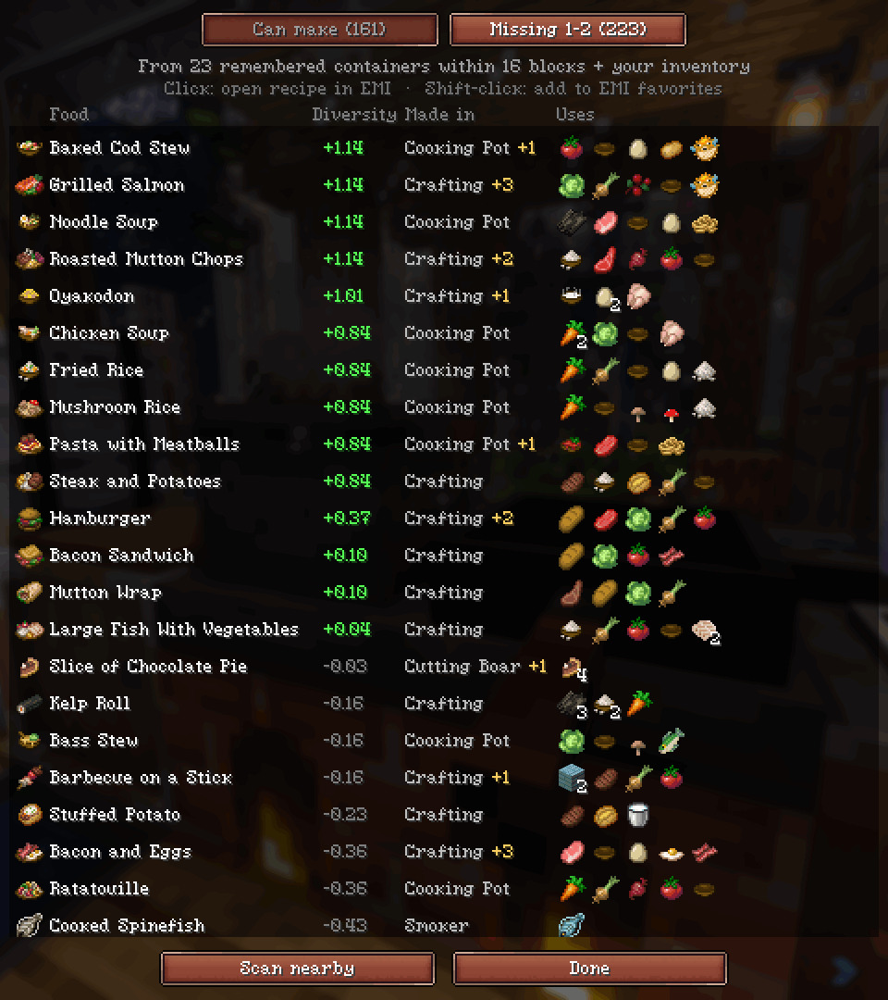
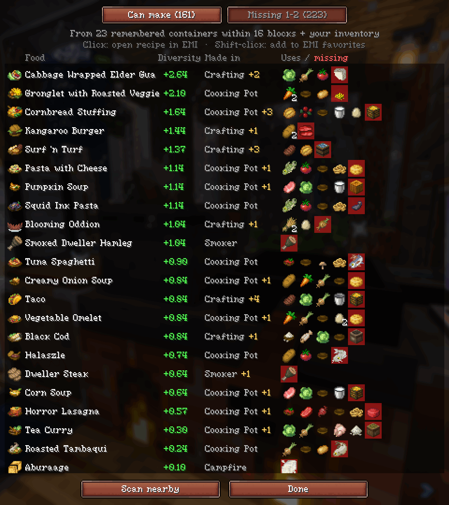

# Food Planner

A client-side Forge 1.20.1 mod for the [Craft to Exile 2 modpack](https://www.curseforge.com/minecraft/modpacks/craft-to-exile-2). It lists the foods you can cook from the items in your inventory and in containers near you, sorted by how much each one would raise your [Spice of Life: Onion](https://modrinth.com/mod/spice-of-life-onion) food diversity.

| Can make | Missing 1-2 |
| --- | --- |
|  |  |

## Download

**[Download the latest build (foodplanner.jar)](https://github.com/seriaati/foodplanner/releases/latest/download/foodplanner.jar)**, rebuilt on every push to `master`. Drop it into your instance's `mods` folder.

## Features

- **Can make**: every food you can cook right now, including meals that take up to 3 steps (for example flour, then dough, then pasta). Hover the gold `+N` next to the station to see the steps.
- **Missing 1-2**: meals you are one or two ingredients away from, with the missing ones highlighted in red.
- **Diversity first**: foods are sorted by the diversity gain Spice of Life would give you for eating them, so things you ate recently drop down the list.
- **EMI integration**: click a food to open its recipe in EMI, or shift-click to add it to your EMI favorites.

## Usage

Press **F6** to open the planner (rebind under Controls > Misc).

The mod runs only on your client, and a multiplayer client can't see inside a container until it's opened. So the planner:

- remembers the contents of every container you open and close, and uses those within 16 blocks of you, plus your inventory, and
- has a **Scan nearby** button that opens and closes each container within reach for a moment to refresh what it remembers. It switches to an empty hotbar slot during the scan so it never places or uses the item you're holding.

Remembered contents are saved per server in `.minecraft/foodplanner/`.

## Requirements

- Minecraft 1.20.1 with Forge 47+
- Spice of Life: Onion
- Farmer's Delight
- EMI

## Building

Requires JDK 17.

```
./gradlew build
```

The mod jar is written to `build/libs/`. GitHub Actions builds it on every push and uploads the jar as a workflow artifact.
